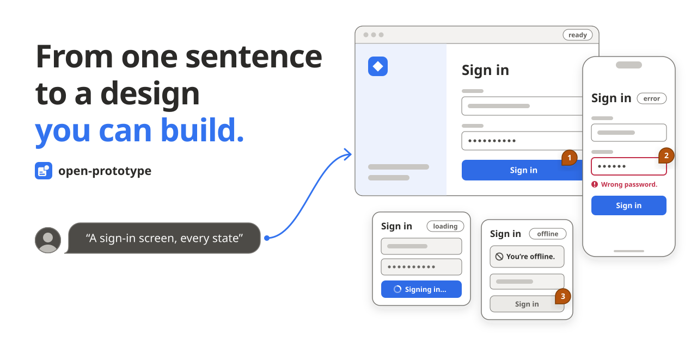
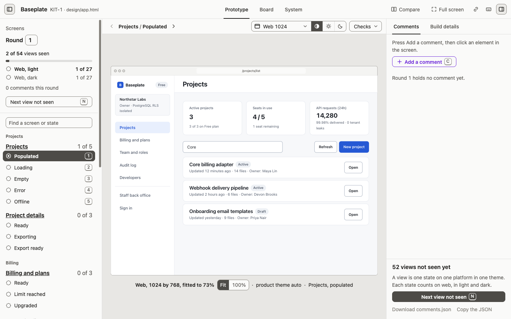
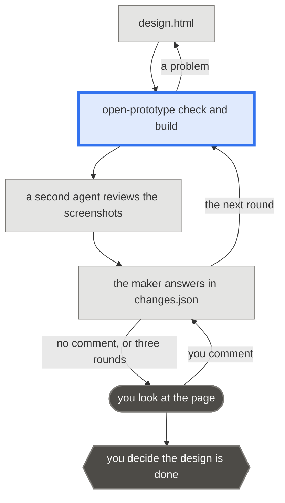

# open-prototype

Design UI prototypes as plain HTML, from a first draft to a reviewed design ready to build. You, or your AI agent, write the design from your project's `DESIGN.md`. The `open-prototype` command checks it, shows every screen and state in one page, and keeps each round of review next to it. A person decides when it's ready.

<picture>
  <source media="(max-width: 600px) and (prefers-color-scheme: dark)" srcset="docs/images/hero-mobile-dark.svg">
  <source media="(max-width: 600px)" srcset="docs/images/hero-mobile-light.svg">
  <source media="(prefers-color-scheme: dark)" srcset="docs/images/hero-dark.svg">
  
</picture>

## Why

- **It's for interfaces.** It makes clickable UI prototypes: screens, flows, and every state, on phone, tablet, and desktop, in your design system. It doesn't make brand artwork, Figma files, slides, videos, or production code. It's what you build from.
- **A design is plain HTML.** The tool reads only attributes that start with `data-proto-`, and it never changes your file. A designer, a developer, or an AI agent can write one.
- **Every problem points to a line.** `check` names each problem with its rule, file, and line. It refuses scripts, so nothing in a design runs.
- **Every view in one page.** The viewer shows every screen and state on each platform and theme. `shots` lists the screenshots a review needs, and can take them.
- **The review stays with the design.** Comments, and the changes that answer them, are files next to the design. Nothing leaves your machine, and the tool never approves a design. A person does.

## Install

The tool runs on Bun 1.4.4 or newer, on macOS, Linux, and Windows. It isn't on npm. To take screenshots, it also needs Chrome or Chromium.

**With your AI agent.** Run your agent's install line once. It adds the prototyping skill to every project. In Claude Code and OpenCode, it also adds the `open-prototype` command.

| Agent | Install |
| --- | --- |
| Claude Code | `/plugin install open-prototype --marketplace thaithienvanid/open-prototype` |
| Antigravity | `agy plugin install https://github.com/thaithienvanid/open-prototype` |
| Codex | `codex plugin marketplace add thaithienvanid/open-prototype && codex plugin add open-prototype@open-prototype` |
| Muse Code | `muse plugins marketplace add open-prototype https://github.com/thaithienvanid/open-prototype && muse plugins install open-prototype@open-prototype` |
| OpenCode 2 or later | `opencode plugin add github:thaithienvanid/open-prototype` |

In Antigravity, Codex, and Muse Code, install the command too, as shown below. For any other agent, copy `skills/prototyping/` into the folder it loads skills from. [The install steps](llms-install.md) cover each agent, its permissions, and what each install showed when it was tested.

**Just the command.** Run `bun add -g github:thaithienvanid/open-prototype` to put `open-prototype` on your PATH. To try it once without installing, run `bunx github:thaithienvanid/open-prototype <command>`. Without Bun, download the single-file binary for your system from a release, once the first release is out. [The install steps](llms-install.md#with-no-bun-a-release-binary) list each file and how to verify it. To work on the tool itself, see [CONTRIBUTING.md](CONTRIBUTING.md).

**Update and uninstall.** Run `bun add -g` or `agy plugin install` again to update. Claude Code can update the plugin for you: turn on auto-update for the `open-prototype` marketplace in `/plugin`. [The install steps](llms-install.md#update-and-uninstall) list every update and uninstall command.

The tool keeps nothing outside your project. `.prototype/` holds only what it built, so you can delete it at any time. Your designs, `prototype.config.json`, and each design's `rounds/` folder are yours. Comments you haven't downloaded yet are kept in your browser, and the install steps say how to clear them.

## Your first design

Run every command from your project's top folder. The tool treats that folder as the project and writes only inside it. In an empty folder:

```sh
open-prototype new-design design/first.html
open-prototype check design/first.html
open-prototype build design/first.html
open-prototype shots design/first.html
```

- `new-design` writes a starter design.
- `check` looks for problems. Here it prints `ok: 1 screen, 2 states, 4 test ids`.
- `build` writes the page, `.prototype/views/design/first.html`, and prints its address. Add `--open` to open it in your browser.
- `shots` lists the screenshots a review needs. Add `--capture` to take them with Chrome.

To keep the page open while you edit, run `open-prototype serve design/first.html` instead of `build`. It serves the page at `http://127.0.0.1:8765`, or the next free port if that one is busy, and rebuilds it each time you reload.

Now edit `design/first.html`, and check it again. Before your second design, read `open-prototype guide`: it prints the whole format, with an example of each attribute.

- **In a project that already has screens,** start with `open-prototype project`. It shows the project's `DESIGN.md`, token files, and Storybook stories.
- **With no `DESIGN.md` yet,** `open-prototype new-design-md` starts one.
- **As a design grows,** it stays one file. Move a group of screens into `flows/`, and any piece of UI you use twice into `blocks/`.

The page loads nothing from the network, so a brand font comes from font files in your project, as the guide's "Fonts" part shows. If you use Tailwind, your `DESIGN.md` tokens become Tailwind v4 custom properties, such as `--color-primary`.

For scripts, add `--json`. Every command except `serve` then prints one JSON object: `schema_version`, `ok`, `target`, and `findings`, then the command's own keys. Match a finding by its rule id, not its wording.

## See it first

`open-prototype example` writes and builds Baseplate, an example SaaS app with six flows, nine screens, 27 states, and six shared blocks, in light and dark. Its page looks like this:

<picture>
  <source media="(prefers-color-scheme: dark)" srcset="docs/images/showcase-dark.png">
  
</picture>

## Review a design

**Agents review, you decide.** A review happens in rounds of comments, saved as files next to the design. With the skill, your agent first runs a few rounds with a second agent, then gives you the page.



1. **The agent builds the page.** Never open a design file you did not write directly in a browser, because the browser would run its scripts and load what it links to. View it through `open-prototype build` or `open-prototype serve` instead.
2. **A second agent reviews it.** An agent that didn't make the design reads the screenshots and writes a round of comments, signing each one in its `by` field. `open-prototype save-comments` saves the round next to the design, and never overwrites an earlier one.
3. **The maker answers and rebuilds.** The next round's `changes.json` says which comments each change answers, such as `{"changes": [{"answers": ["r1-1"], "summary": "The error says what did not load."}]}`. Rounds repeat until one has no comments, up to three rounds.
4. **You decide.** You get the page, with how many rounds ran, what changed, what's still open, and any assumptions or draft copy. Add comments, or say in your own words that the design is done. The tool never records an approval.

If no second agent is available, your agent tells you and shows you the page first. If no one is there to answer, as in an automated run, the agent reports back after its rounds.

**To comment yourself,** open the page your agent gives you. The Screens panel counts the views you've seen, and `N` jumps to the next one you haven't. Press `C`, click an element, and write what to change. Then download `comments.json`, or copy the round for your agent. `open-prototype save-comments comments.json design/first.html` saves it as the design's next round, in `design/rounds/first/`. Your agent answers it just like an agent's round.

For a private review, or one on a phone, use `open-prototype serve`, and add `--lan` for the phone. [Section 12 of the technical specification](docs/tech-spec.md#12-safety) explains why, and what the tool protects against.

## Docs

| Use it | Understand it | Contribute |
| --- | --- | --- |
| [Install for an agent](llms-install.md) | [Product specification](docs/product-spec.md) | [Contributing](CONTRIBUTING.md) |
| [The prototyping skill](skills/prototyping/SKILL.md) | [Technical specification](docs/tech-spec.md) | [Security](SECURITY.md) |
| [Reference](docs/reference.md) | [Changelog](CHANGELOG.md) | |
| [Map for an agent](llms.txt) | | |

## Support

If the tool helps you, you can support its work at [ko-fi.com/thaithienvanid](https://ko-fi.com/thaithienvanid).

## Licence

Apache-2.0, see [`LICENSE`](LICENSE).

Built with Claude Code.
